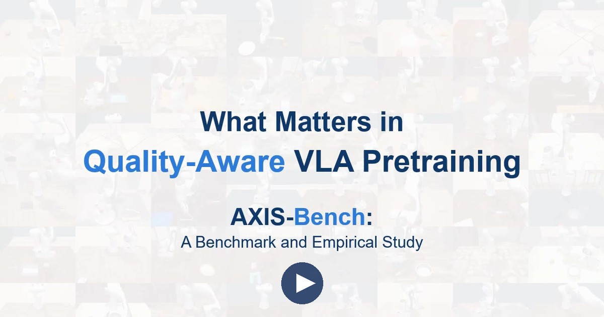
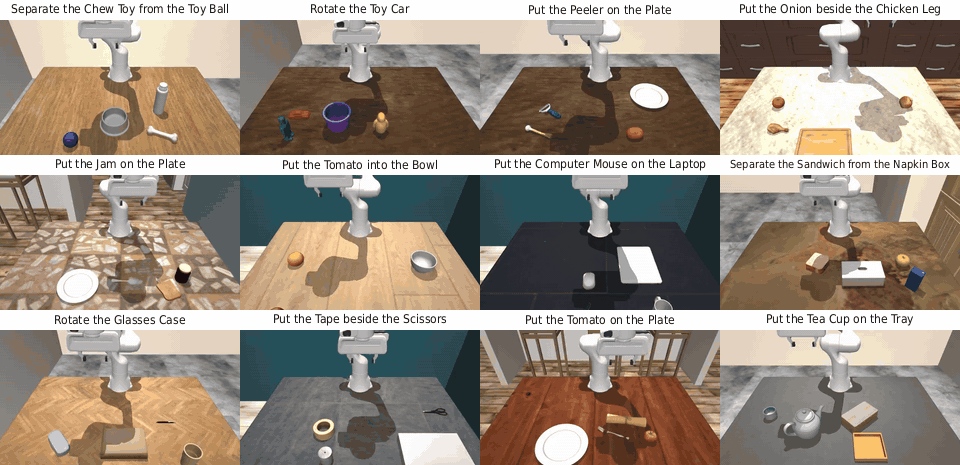
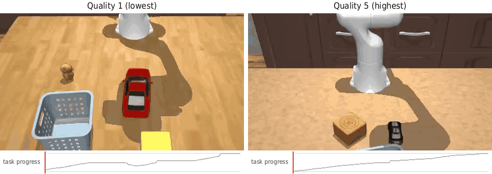
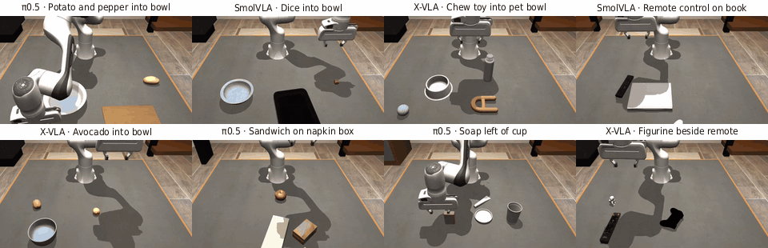
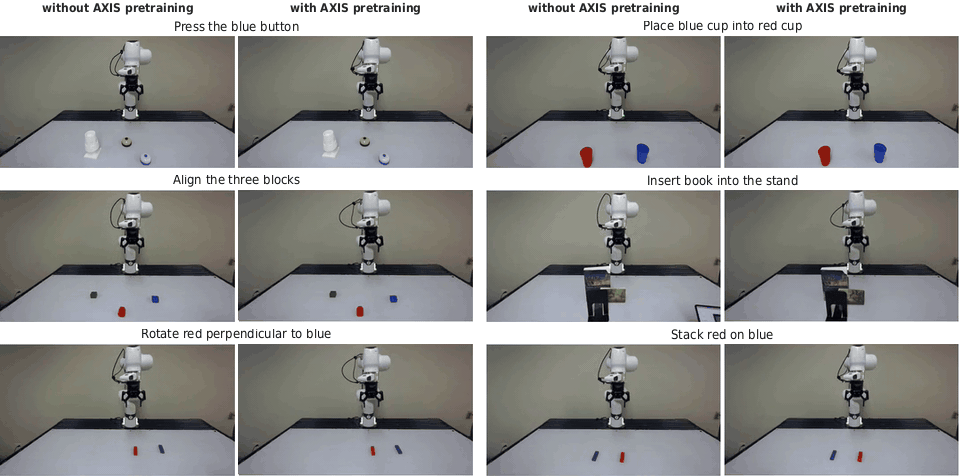
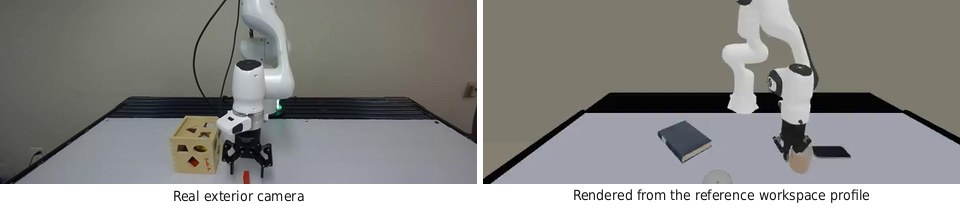
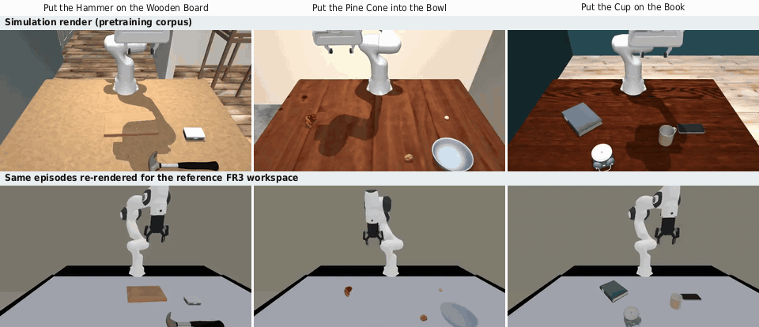

<h1 align="center">AXIS-Bench</h1>
<h3 align="center">What Matters in Quality-Aware VLA Pretraining: A Benchmark and Empirical Study</h3>

<p align="center">
  <a href="https://arxiv.org/abs/2610.18869"></a>
  <a href="https://axis-bench.github.io/"></a>
  <a href="https://axis-bench.github.io/axis-bench/"></a>
  <a href="https://huggingface.co/axisrobotics"></a>
  <a href="https://arxiv.org/abs/2607.21588"></a>
  <a href="LICENSE"></a>
</p>

<p align="center">
  <a href="https://axis-bench.github.io/"></a>
  <br><sub>Watch the three-minute introduction to AXIS-Bench.</sub>
</p>

# Overview

How should a vision-language-action (VLA) policy use demonstrations that vary in quality? AXIS-Bench lets researchers study that question during pretraining and evaluate policies after fine-tuning on target tasks.

It provides human demonstrations in simulation with recorded object and contact states, so you can define your own quality labels. The released data also includes labels from two progress-based reward definitions at both episode and action-chunk level. You can use loss weighting, data filtering, quality conditioning, or your own method to pretrain π0.5, SmolVLA, and X-VLA.

You can fine-tune and evaluate policies on 24 held-out simulation tasks using the paper's fixed initial layouts and evaluation protocol. Replayable trajectories also let you re-render pretraining observations for a real workspace before fine-tuning on demonstrations of your own target tasks. For findings, see the [paper](https://arxiv.org/abs/2610.18869).

<p align="center">
  
</p>

# Updates

- **2026/10/29** AXIS-Bench v1.0 releases the code, data, and checkpoints.
- **2026/10/13** The [paper](https://arxiv.org/abs/2610.18869) is available on arXiv.

# Installation

```bash
git clone --recurse-submodules https://github.com/axis-bench/axis-bench && cd axis-bench
pip install -e ".[reproduce]"
qvla init
```

For evaluation, rendering, or backbone-specific training, follow the environment instructions in the [installation guide](docs/install.md).

# Task information

**Pretraining tasks.** The controlled study draws on 5,000 human demonstrations across 731 simulated Franka tasks. Recorded states support progress-based quality labels for these trajectories.

<p align="center">
  
  <br><sub>Twelve examples from the 5,000-demonstration, 731-task pretraining set.</sub>
</p>

**Demonstration quality.** The approach-aware score measures progress during approach and manipulation. The examples below show two successful demonstrations of the same task, at episode-quality levels 1 (lowest) and 5 (highest).

<p align="center">
  
  <br><sub>Approach-aware episode quality on one task: the lowest-quality demonstration drops the car and regrasps it, so its task-progress curve dips and stalls; the highest-quality one grasps and places it in one go, and its curve rises steadily.</sub>
</p>

**Evaluation.** Policies are fine-tuned on target-task demonstrations, then tested on the same 50 initial layouts for each of 24 held-out tasks.

<p align="center">
  
  <br><sub>Successful rollouts from π0.5, SmolVLA, and X-VLA on held-out tasks, shown at roughly 2.4–4.5× real-time speed.</sub>
</p>

# Real-world pretraining data

<p align="center">
  
  <br><sub>Real-robot rollouts on the FR3 reference workspace: π0.5 fine-tuned on real demonstrations, without (left of each pair) and with (right) plain-BC pretraining on the re-rendered data. ✓ marks a recorded success and ✗ a recorded failure. Sped up.</sub>
</p>

The policy on the right of each pair was pretrained on simulation episodes re-rendered for this workspace. For your robot, you re-render the episodes for your workspace the same way, then fine-tune on demonstrations of your own tasks. A workspace profile sets the exterior camera, the table and the background. Below are the reference workspace and three pretraining episodes re-rendered for it. To do the same for your workspace, see [Real world: your workspace](docs/tutorials/real-world-your-workspace.md).

<p align="center">
  
  <br><sub>The reference workspace: its real exterior camera, and the same view rendered from its workspace profile.</sub>
</p>

<p align="center">
  
  <br><sub>Three pretraining episodes: top, the simulation render; bottom, the same episodes re-rendered for the reference workspace.</sub>
</p>

# Usage

The [documentation](https://axis-bench.github.io/axis-bench/) has three entries:

- [Reproduce the paper](docs/tutorials/reproduce-from-results.md): recompute its tables from the published results on a CPU with `qvla paper tables --check`, or [re-evaluate the released checkpoints](docs/tutorials/reeval-released-checkpoints.md) on a GPU.
- [Train with your quality method](docs/tutorials/write-a-quality-method.md): write the method; pretraining, fine-tuning and evaluation follow the benchmark protocol, one command each.
- [Connect your own model or robot](docs/tutorials/connect-your-own-model.md): evaluate any policy behind a small server, or [run the real-world line on your workspace](docs/tutorials/real-world-your-workspace.md).

# Data and checkpoints

The datasets, results, and trained checkpoints are published under [`axisrobotics`](https://huggingface.co/axisrobotics) with the `v1.0` tag:

| repository | contents |
|---|---|
| [`qvla-v1-corpus`](https://huggingface.co/datasets/axisrobotics/qvla-v1-corpus) | Controlled-study pretraining data, frame index, quality labels, training weights, checksum manifest, and sample traces |
| [`qvla-v1-bench`](https://huggingface.co/datasets/axisrobotics/qvla-v1-bench) | Fine-tuning demonstrations, tasks and success checkers, scene assets, and evaluation layouts |
| [`qvla-v1-results`](https://huggingface.co/datasets/axisrobotics/qvla-v1-results) | Per-seed rollout logs, results map, and `expected/` |
| [`qvla-v1-realworld`](https://huggingface.co/datasets/axisrobotics/qvla-v1-realworld) | Replayable source trajectories and related records for the 19,250 simulated pretraining episodes across 663 tasks that the real-world line pretrains on |
| [`qvla-v1-pi05`](https://huggingface.co/axisrobotics/qvla-v1-pi05), [`qvla-v1-smolvla`](https://huggingface.co/axisrobotics/qvla-v1-smolvla), [`qvla-v1-xvla`](https://huggingface.co/axisrobotics/qvla-v1-xvla) | Checkpoints used for the paper's simulation results |

Use `qvla data get <corpus|bench|results|realworld|traces-sample|checkpoints/<run>>` to download a repository and verify its files. Use `qvla data verify` to check hosted files without downloading them; see [getting the data](docs/reference/data.md).

Use `qvla data get base-weights` to download and verify the π0.5, SmolVLA, and X-VLA base weights from their original publishers. The π0.5 bases are subject to the Gemma Terms of Use.

# Citation

```bibtex
@article{yan2026matters,
  title={What Matters in Quality-Aware VLA Pretraining: A Benchmark and Empirical Study},
  author={Yan, Mingxuan and Gong, Litian and Huang, Dihong and Li, Zhixu and Zhang, Tianyu and Zhang, Wenqian and Jiang, Hefeifei and Li, Peihao and Zhang, Jian and Zhao, Mengfei and others},
  journal={arXiv preprint arXiv:2610.18869},
  year={2026}
}

@article{zhao2026axis,
  title={AXIS: A Growable Community-Driven Data Engine for Scalable Robot Manipulation},
  author={Zhao, Mengfei and Huang, Dihong and Tang, Yikai and Li, Peihao and Yan, Mingxuan and Zhuang, Ruiqi and Huang, Yanjia and Wang, Jie and Zhai, Hai and Zhou, Tony and others},
  journal={arXiv preprint arXiv:2607.21588},
  year={2026}
}
```

# Acknowledgement

We thank [Axis Robotics](https://axisrobotics.ai/) for the AXIS data engine, the community contributors who recorded the human demonstrations on it, and the computing resources that supported this work.

# License

The code is licensed under Apache-2.0 ([LICENSE](LICENSE)). Third-party notices are in [NOTICE](NOTICE). The data and checkpoints use the licenses stated in their repository cards.
